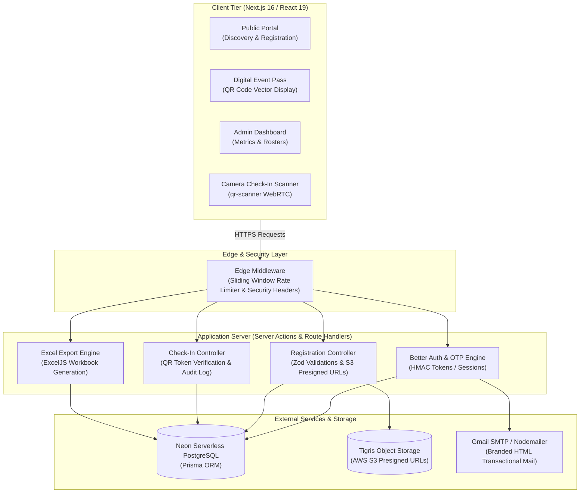

# CodeHive 2K26 2.0

> High-performance hackathon operations and event management platform powering **CodeHive 2K26 2.0**, a National Level Technical Hackathon organized by the Department of Computer Science and Business Systems (CSBS) at Vel Tech Multi Tech Dr. Rangarajan Dr. Sakunthala Engineering College in association with Sri Vensy Technologies Pvt. Ltd.

[](https://nextjs.org/)
[](https://react.dev/)
[](https://www.typescriptlang.org/)
[](https://tailwindcss.com/)
[](https://www.prisma.io/)
[](https://neon.tech/)
[](LICENSE)

---

## Table of Contents

- [Overview](#overview)
- [Key Features](#key-features)
  - [Participant Experience](#participant-experience)
  - [Event Operations & Check-In](#event-operations--check-in)
  - [Admin Command Center](#admin-command-center)
  - [Security & Cyber Defense](#security--cyber-defense)
  - [UI & Visual Engineering](#ui--visual-engineering)
- [System Architecture](#system-architecture)
- [Technology Stack](#technology-stack)
- [Repository Structure](#repository-structure)
- [Getting Started](#getting-started)
  - [Prerequisites](#prerequisites)
  - [Installation](#installation)
  - [Environment Configuration](#environment-configuration)
  - [Database Migration & Seeding](#database-migration--seeding)
  - [Running Locally](#running-locally)
- [Environment Variables](#environment-variables)
- [Core Workflows & Server Actions](#core-workflows--server-actions)
- [API Endpoints](#api-endpoints)
- [Deployment Guide](#deployment-guide)
- [Verification & Quality Checks](#verification--quality-checks)
- [Contributing](#contributing)
- [License & Acknowledgments](#license--acknowledgments)

---

## Overview

**CodeHive 2K26 2.0** is an enterprise-grade hackathon operations system engineered to handle end-to-end event logistics for large-scale engineering symposiums. Built on **Next.js 16 (Turbopack)** and **React 19**, the platform replaces disconnected forms, spreadsheets, and manual desk ticketing with a unified, real-time ecosystem.

### Problems Solved
- **Team Verification Bottlenecks**: Prevents invalid team sizes, duplicate emails, and unregistered member entries through transactional schema constraints.
- **Physical Check-In Delays**: Replaces physical paper lists with dynamic, cryptographically signed QR code digital event passes scanned live by staff devices.
- **Logistics & Transportation Chaos**: Automatically captures attendee college bus route preferences (AC and Non-AC Chennai networks) and compiles route manifests.
- **Data Integrity & Reporting**: Enables real-time analytics and formatted Excel exports (`.xlsx`) directly to event coordinators for logistics, food distribution, and certification rosters.

---

## Key Features

### Participant Experience
- **Multi-Track Challenge Discovery**: Detailed briefs for official competition tracks:
  - **TECH FORGE**: 2-day technical challenge (Analyze, Build, Adapt & Defend).
  - **AGENT VIBE**: 2-day artificial intelligence & autonomous agent challenge.
- **Structured Team Registration**: Enforces 3-member team requirements with validated leader profiles, member credentials, and college ID card document uploads via AWS S3 presigned URLs.
- **Digital Event Pass**: Interactive vector pass rendering verified registration numbers (`CH26-XXXX`), attendee details, event schedules, and unique QR attendance tokens.
- **Transportation Coordination**: Integrated route selection for college bus services (AC & Non-AC routes) with landmark and bus stop mapping, accompanied by downloadable route manifests.

### Event Operations & Check-In
- **Live Camera QR Attendance Scanner**: Browser-based scanner (`qr-scanner`) allowing coordinators to scan attendee passes on smartphones or laptops without dedicated hardware.
- **Instant Attendance Validation**: Instant feedback showing participant credentials, team name, and college. Enforces duplicate check-in prevention with timestamp and device logging.
- **Audit Trails**: Every administrative and check-in action is committed to an immutable `AuditLog` table with actor ID, IP address, and payload metadata.

### Admin Command Center
- **Real-Time Telemetry Dashboard**: Live metrics tracking total registrations, verified participants, check-in completion percentages, and transport utilization.
- **Participant & Team Rosters**: Multi-field search, filtering by college, department, and registration status, with inline status toggle controls.
- **Automated Excel Reporting**: Built-in `exceljs` export engine generating formatted workbooks for attendance verification, bus route allocations, and jury scoring sheets.
- **Dynamic Event Management**: Admin dialogs to adjust event capacities, edit venue instructions, toggle registration deadlines, and publish updates.

### Security & Cyber Defense
- **Layer 7 DDoS Shield Middleware**: Sliding-window rate limiter protecting API routes across tailored tiers (`upload`, `auth`, `check-in`, `admin_api`, and `global`).
- **Hardened HTTP Headers**: Strict Content-Security-Policy, HSTS, `X-Frame-Options: DENY`, `X-Content-Type-Options: nosniff`, and Referrer-Policy enforcement.
- **Authentication**: Powered by **Better Auth** with PostgreSQL session storage, OAuth (Google & GitHub), role-based route guards (`ADMIN` vs. `PARTICIPANT`), and passwordless SMTP email OTP with HMAC verification.

### UI & Visual Engineering
- **Cyberpunk Dark Aesthetic**: Minimalist monochrome interface with high-contrast JetBrains Mono typography, custom SVG tokens, and zero visual clutter.
- **Dynamic ASCII Perspective Corridor**: Vanilla Canvas-rendered 3D vanishing perspective tunnel running smoothly in the hero background.
- **Hybrid Hero Motion Reveal**: Synchronized GSAP 3.15 Latin alphabet (`A-Z`) cipher scramble blended with fluid mechanical vertical number rolls powered by `@number-flow/react`.
- **Architectural Masking**: Structural `overflow-hidden` masked line wipes and geometric laser unmasks for editorial typography presentation.

---

## System Architecture



---

## Technology Stack

| Domain | Technology | Purpose |
| :--- | :--- | :--- |
| **Framework** | Next.js 16.3.7 (Turbopack) | React Server Components, Server Actions, App Router architecture |
| **Frontend Library** | React 19.2.8 | UI component tree and reactive client states |
| **Language** | TypeScript 5.x | End-to-end static typing and Zod schema inference |
| **Styling** | Tailwind CSS v4, PostCSS | Modern atomic utility classes and CSS theme tokens |
| **Motion & Animation** | GSAP 3.15, `@gsap/react` | Hero cryptographic alphabet scramble and architectural timeline reveals |
| **Number Transitions** | `@number-flow/react`, Framer Motion | Fluid vertical odometer digit reel physics in hero title & prize counters |
| **Database & ORM** | Prisma 6.19.3 | Type-safe query client, migrations, and relational modeling |
| **Database Engine** | PostgreSQL (Neon Serverless) | ACID-compliant relational persistence with connection pooling |
| **Authentication** | Better Auth 1.7.6 | Session management, OAuth adapters, and role-based guards |
| **Object Storage** | Tigris (`@aws-sdk/client-s3`) | S3-compatible cloud storage for participant college ID document uploads |
| **Email Delivery** | Nodemailer 10.0 | Transactional email delivery for OTP verification and registration passes |
| **QR Code Engine** | `qrcode`, `qr-scanner` | Vector QR pass generation and live camera attendance scanning |
| **Data Export** | ExcelJS 4.4.0 | Formatted `.xlsx` workbook generation for offline event logistics |
| **Package Manager** | pnpm 10.32.1 | Fast, deterministic, workspace-aware dependency resolution |

---

## Repository Structure

```
codehive/
├── actions/                     # Server Actions (Business Logic)
│   ├── admin-settings.ts        # Admin controls and system metrics
│   ├── checkin.ts               # Attendee QR scan validation & audit logs
│   ├── event.ts                 # Event CRUD and category queries
│   ├── otp.ts                   # Passwordless email OTP generation & verification
│   ├── participant.ts           # Participant profile queries
│   ├── registration.ts          # Team registration, validation & pass dispatch
│   └── team.ts                  # Team lookups and membership queries
├── app/                         # Next.js App Router Structure
│   ├── (public)/                # Public attendee portal
│   │   ├── events/              # Event catalog and dynamic event detail views
│   │   ├── register/            # Team registration wizard
│   │   ├── registration/[id]/   # Digital Event Pass viewer with QR code
│   │   └── page.tsx             # Hero landing page with ASCII corridor
│   ├── admin/                   # Authenticated Coordinator Command Center
│   │   ├── check-in/            # Live camera QR attendee scanner
│   │   ├── dashboard/           # Registration analytics and telemetry
│   │   ├── events/              # Event management interface
│   │   ├── participants/        # Attendee roster with Excel export
│   │   ├── registrations/       # Team and individual registration records
│   │   ├── reports/             # Logistics and route reports
│   │   └── settings/            # Configuration and system settings
│   ├── api/                     # Route Handlers
│   │   ├── auth/                # Better Auth handler & OTP endpoints
│   │   ├── check-in/            # API check-in validation endpoint
│   │   ├── health/              # Liveness and uptime probe
│   │   └── upload/              # S3 presigned URL generator for college IDs
│   ├── layout.tsx               # Root HTML layout with Google Font variables
│   └── globals.css              # Tailwind v4 theme configuration
├── components/                  # Reusable UI & Feature Components
│   ├── home/                    # Hero components, Cyber title, About, Prizes
│   ├── tickets/                 # Digital Event Pass rendering components
│   ├── ui/                      # Base primitive components (buttons, dialogs, inputs)
│   ├── header.tsx               # Sticky navigation header
│   └── hero-actions.tsx         # Primary call-to-action buttons
├── lib/                         # Core Infrastructure & Utilities
│   ├── auth.ts                  # Better Auth server configuration
│   ├── auth-guard.ts            # Role-based route guard helpers
│   ├── email-templates.ts       # HTML transactional email templates
│   ├── export-excel.ts          # ExcelJS workbook generation engine
│   ├── mailer.ts                # Nodemailer SMTP transporter setup
│   ├── prisma.ts                # PrismaClient singleton instance
│   ├── rate-limiter.ts          # In-memory sliding window rate limiter
│   └── tigris.ts                # Tigris S3 storage client & presigner
├── prisma/                      # Database Layer
│   ├── schema.prisma            # Prisma schema models, enums & relations
│   └── seed.ts                  # Database seeder (categories & hackathon tracks)
├── public/                      # Static Assets
│   ├── images/                  # Official event branding and logo assets
│   └── routes/                  # AC & Non-AC College Bus route detail PDFs
├── env.ts                       # Type-safe environment validation via Zod
├── middleware.ts                # Layer 7 Anti-DDoS rate limiting and HTTP headers
├── package.json                 # Project scripts and dependency declarations
└── tsconfig.json                # TypeScript compiler configuration
```

---

## Getting Started

### Prerequisites

Ensure the following runtimes and tools are installed:
- **Node.js**: `v20.x` or higher (LTS recommended)
- **pnpm**: `v10.x` (`npm install -g pnpm`)
- **PostgreSQL Database**: Local PostgreSQL instance or a serverless [Neon](https://neon.tech/) database URL.
- **SMTP Account**: A valid Gmail account with an App Password or an SMTP provider.
- **S3 / Tigris Storage Account**: For document uploads (Tigris or AWS S3).

### Installation

1. **Clone the repository**:
   ```bash
   git clone https://github.com/Dev-Madhan/codehive2k26.git
   cd codehive
   ```

2. **Install dependencies**:
   ```bash
   pnpm install
   ```

### Environment Configuration

Create a local environment file by copying `.env.example`:

```bash
cp .env.example .env
```

Open `.env` and configure the mandatory values. See the [Environment Variables](#environment-variables) section below for detailed definitions.

### Database Migration & Seeding

1. **Generate Prisma Client**:
   ```bash
   pnpm exec prisma generate
   ```

2. **Push Schema to PostgreSQL**:
   ```bash
   pnpm exec prisma db push
   ```

3. **Seed Database with Categories & Hackathon Challenges**:
   ```bash
   pnpm exec tsx prisma/seed.ts
   ```

### Running Locally

Start the Next.js development server with Turbopack:

```bash
pnpm run dev
```

Open [http://localhost:3000](http://localhost:3000) in your browser.

---

## Environment Variables

All environment variables are validated at runtime in [env.ts](file:///d:/Madhan%20Kumar/Web%20Development%20Projects/codehive/env.ts) via Zod schemas:

| Variable | Required | Default | Description |
| :--- | :---: | :--- | :--- |
| `DATABASE_URL` | **Yes** | — | PostgreSQL connection string (pooled URL for Neon) |
| `DIRECT_URL` | No | — | Direct PostgreSQL connection string for Prisma migrations |
| `BETTER_AUTH_SECRET` | **Yes** | — | 32-byte secret key used to sign authentication cookies and tokens |
| `BETTER_AUTH_URL` | No | `http://localhost:3000` | Canonical base URL for Better Auth authentication callbacks |
| `NEXT_PUBLIC_APP_URL` | No | `http://localhost:3000` | Publicly reachable application URL for client assets |
| `GOOGLE_CLIENT_ID` | No | `""` | Google OAuth Client ID for participant sign-in |
| `GOOGLE_CLIENT_SECRET` | No | `""` | Google OAuth Client Secret |
| `GITHUB_CLIENT_ID` | No | `""` | GitHub OAuth Client ID for participant sign-in |
| `GITHUB_CLIENT_SECRET` | No | `""` | GitHub OAuth Client Secret |
| `AWS_ACCESS_KEY_ID` | No | `""` | S3 / Tigris Storage Access Key ID |
| `AWS_SECRET_ACCESS_KEY` | No | `""` | S3 / Tigris Storage Secret Access Key |
| `AWS_REGION` | No | `"auto"` | Object storage region |
| `AWS_ENDPOINT_URL_S3` | No | `https://t3.storage.dev` | Object storage S3 endpoint URL |
| `AWS_BUCKET_NAME` | No | `"codehive"` | Storage bucket name for attendee ID card uploads |
| `SMTP_HOST` | No | `"smtp.gmail.com"` | Outgoing SMTP server hostname |
| `SMTP_PORT` | No | `"587"` | Outgoing SMTP server port (587 for TLS) |
| `SMTP_USER` | No | `""` | SMTP sender account email address |
| `SMTP_PASS` | No | `""` | SMTP sender authentication password (Gmail App Password) |
| `EMAIL_FROM` | No | `CodeHive 2K26 <no-reply@...>` | Display sender string for outbound email headers |
| `EMERGENCY_OTP_BYPASS` | No | `"false"` | Emergency switch (`"true"`/`"false"`) allowing `123456` in local dev |

---

## Core Workflows & Server Actions

The platform leverages **Next.js Server Actions** for database operations:

### 1. Team Registration (`actions/registration.ts`)
- **`registerForEvent(formData)`**:
  - Validates minimum and maximum team constraints (e.g., exactly 3 members for Tech Forge).
  - Verifies that participant emails are not registered for the same event (`participant_event_unique` index).
  - Creates the `Team`, `TeamMember`, and `Registration` entities in a single atomic database transaction.
  - Automatically generates an alphanumeric registration number (`CH26-XXXX`) and signed `qrToken`.
  - Dispatches confirmation emails containing the Digital Event Pass link.

### 2. Live QR Check-In Engine (`actions/checkin.ts`)
- **`processCheckIn(qrToken, staffId, deviceInfo)`**:
  - Scans and verifies the provided `qrToken` against confirmed registrations.
  - Rejects invalid tokens or already checked-in attendees.
  - Creates a `CheckIn` record linked to the staff coordinator and logs the event to `AuditLog`.

### 3. Passwordless Email OTP (`actions/otp.ts`)
- **`sendOtp(email)`**:
  - Validates recipient email, applies sliding-window rate limiting, generates a 6-digit cryptographic OTP, and sends a styled HTML email template via Nodemailer.
- **`verifyOtp(email, otp)`**:
  - Compares the supplied OTP against active tokens in the `Verification` table. Upon success, generates an authenticated session.

### 4. Excel Logistics Export (`lib/export-excel.ts`)
- **`generateRegistrationsExcel(eventId?)`**:
  - Compiles full team rosters, member contact numbers, colleges, and bus route pickup landmarks into an Excel workbook (`.xlsx`) formatted with auto-column widths, header styling, and metadata summaries.

---

## API Endpoints

In addition to Server Actions, the platform provides dedicated HTTP Route Handlers:

| Endpoint | Method | Authentication | Description |
| :--- | :---: | :---: | :--- |
| `/api/auth/[...all]` | `GET`, `POST` | Public | Better Auth handler managing OAuth, sessions, and sign-out |
| `/api/auth/send-otp` | `POST` | Public (Rate-limited) | Requests a 6-digit email OTP for passwordless authentication |
| `/api/auth/verify-otp` | `POST` | Public (Rate-limited) | Validates the email OTP and issues session credentials |
| `/api/check-in` | `POST` | Admin / Staff | Validates a scanned QR token and records attendee arrival |
| `/api/upload` | `POST` | Authenticated | Generates an AWS S3 / Tigris presigned PUT URL for ID document uploads |
| `/api/health` | `GET` | Public (Bypasses rate limit) | System health check returning status, timestamp, and database liveness |

---

## Deployment Guide

The platform is designed to deploy on **Vercel** connected to **Neon Serverless PostgreSQL** and **Tigris Object Storage**:

### Deploying to Vercel

1. **Import Repository**: Connect your GitHub repository to [Vercel](https://vercel.com).
2. **Framework Preset**: Vercel automatically detects Next.js.
3. **Build Command**: Set to `prisma generate && next build` (configured in `package.json`).
4. **Environment Variables**: Populate all required environment variables in the Vercel Project Settings:
   - `DATABASE_URL` (use Neon's pooled connection string)
   - `DIRECT_URL` (use Neon's direct connection string for migrations)
   - `BETTER_AUTH_SECRET` (generate with `openssl rand -base64 32`)
   - `BETTER_AUTH_URL` (`https://your-domain.vercel.app`)
   - `NEXT_PUBLIC_APP_URL` (`https://your-domain.vercel.app`)
   - `SMTP_USER` and `SMTP_PASS`
   - `AWS_ACCESS_KEY_ID`, `AWS_SECRET_ACCESS_KEY`, and `AWS_BUCKET_NAME`
   - `EMERGENCY_OTP_BYPASS="false"`
5. **Deploy**: Trigger a production deployment.

---

## Verification & Quality Checks

Run the following validation commands to ensure codebase integrity:

```bash
# Type Checking across all pages and actions
pnpm exec tsc --noEmit

# ESLint validation
pnpm run lint

# Prisma Schema validation
pnpm exec prisma validate

# Build verification
pnpm run build
```

---

## Contributing

Contributions from the organizing committee, technical volunteers, and open-source contributors are welcome.

1. **Fork the repository** on GitHub.
2. **Create a descriptive feature branch**:
   ```bash
   git checkout -b feature/attendance-analytics
   ```
3. **Commit your modifications** using clean, descriptive commit messages:
   ```bash
   git commit -m "feat(check-in): add offline cache support for camera scanner"
   ```
4. **Push to your fork**:
   ```bash
   git push origin feature/attendance-analytics
   ```
5. **Open a Pull Request** against the `main` branch with a summary of changes and test results.

---

## License & Acknowledgments

- **License**: Distributed under the [MIT License](LICENSE).
- **Institution**: Department of Computer Science and Business Systems (CSBS), **Vel Tech Multi Tech Dr. Rangarajan Dr. Sakunthala Engineering College** (Autonomous), Avadi, Chennai, Tamil Nadu, India.
- **Industry Partner**: **Sri Vensy Technologies Pvt. Ltd.**
- **Lead Operations & Development**: Built and maintained by the **CodeHive 2K26 Technical Operations Team**.
